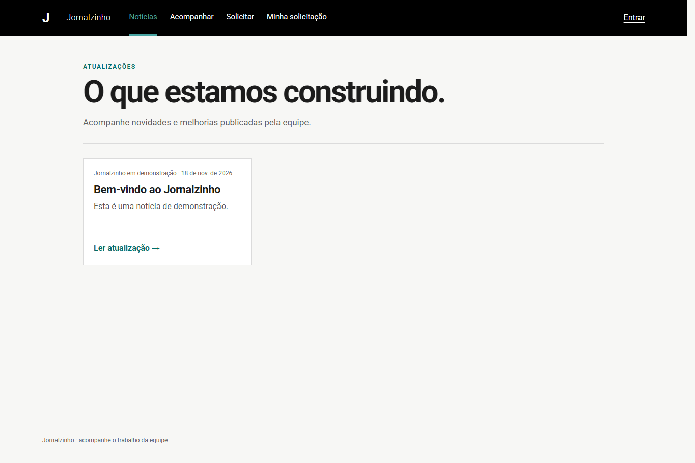
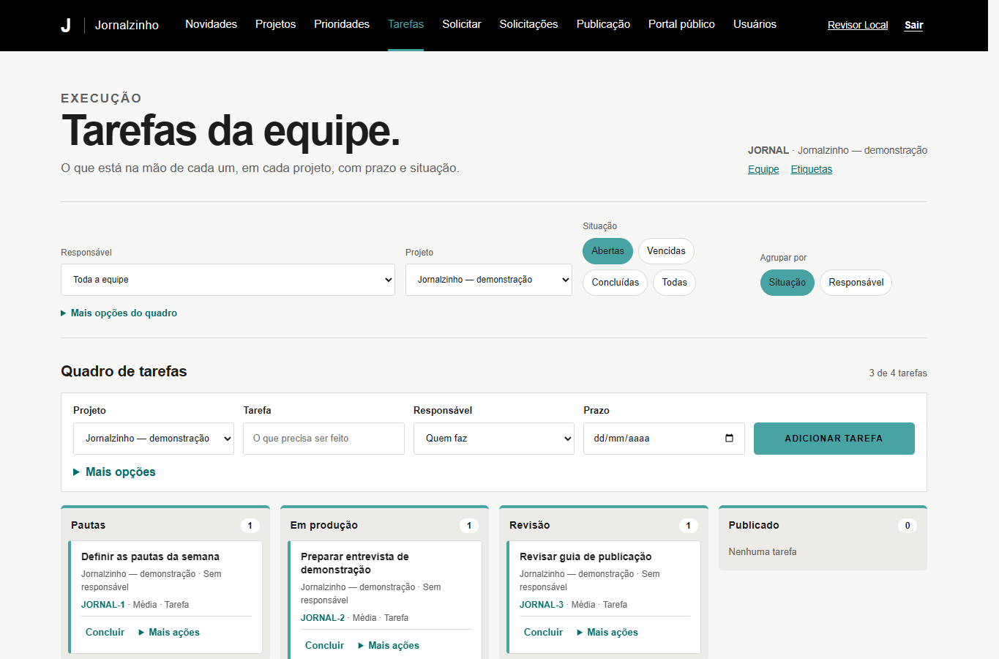
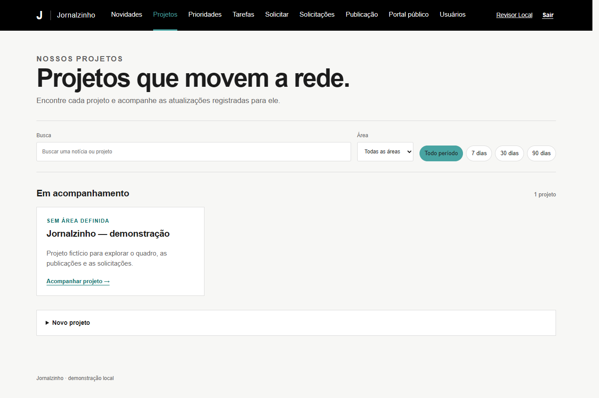

# Jornalzinho

O Jornalzinho reúne um portal de notícias e acompanhamento de entregas com um espaço autenticado para gestão de projetos, quadros Kanban, tarefas, publicações e solicitações. Esta distribuição foi preparada para demonstração local e usa somente dados fictícios.



*Portal público com conteúdo demonstrativo.*



*Kanban do projeto fictício, com quatro tarefas — três ainda abertas.*



*Área de Projetos para localizar o projeto fictício e abrir seu acompanhamento.*

## Recursos

- Portal público para consultar notícias, entregas publicadas, enviar solicitações e acompanhá-las.
- Espaço de equipe com projetos, quadros Kanban, tarefas, comentários, etiquetas e publicações.
- Gestão de usuários e participação por projeto, com papéis globais e controle de acesso por função (RBAC).
- Autenticação com sessão, token de acesso e renovação de sessão; não há cadastro público de contas.
- Dados iniciais fictícios para explorar o projeto, suas tarefas e uma notícia publicada.

## Stack

- Backend: Python, FastAPI, SQLAlchemy e PostgreSQL.
- Frontend: React, TypeScript e Vite.
- Banco e execução local: PostgreSQL 17, Docker e Docker Compose.
- Migrations: Alembic.

## Requisitos

- Docker Desktop em execução.
- Docker Compose v2.
- Windows PowerShell 5.1 ou mais recente.
- Git.

## Executar localmente

Clone o repositório e execute o setup:

```powershell
git clone https://github.com/joaoguilherme23/jornalzinho.git
Set-Location -LiteralPath .\jornalzinho
powershell.exe -NoProfile -ExecutionPolicy Bypass -File .\scripts\setup.ps1
```

O script cria os segredos locais necessários, constrói a imagem, aplica as migrations, insere os dados fictícios e inicia a prévia. Em seguida, abra [http://127.0.0.1:8330](http://127.0.0.1:8330).

A conta administrativa inicial é `admin@jornalzinho.example.test`. A senha aleatória é gravada somente no arquivo local `.admin-credentials`, que é ignorado pelo Git e não é exibido pelo setup. No primeiro acesso, a senha deve ser trocada.

Para encerrar a prévia:

```powershell
docker compose down
```

Para reiniciar preservando os dados locais:

```powershell
docker compose up -d
```

Para apagar também o banco local descartável:

```powershell
docker compose down --volumes
```

## Uso básico

1. Acesse [http://127.0.0.1:8330/app](http://127.0.0.1:8330/app), entre com a conta administrativa inicial e troque a senha.
2. Em **Projetos**, crie ou abra um projeto e abra seu quadro de tarefas.
3. Crie tarefas, defina prioridade, responsável e etiquetas, e mova os cartões pelo Kanban.
4. Em **Publicação**, selecione o que pode aparecer no portal público: projetos, tarefas e notícias.
5. Use **Solicitar** no portal público para enviar uma solicitação; a equipe pode revisar e transformá-la em trabalho interno.
6. Em **Usuários**, administradores criam contas, redefinem senhas e definem vínculos por projeto.

## Limites desta prévia

- O Compose expõe apenas a aplicação em `127.0.0.1:8330`; o PostgreSQL não possui porta publicada.
- Todo o conteúdo inicial é fictício e local.
- A coleta de repositórios e a geração editorial por IA são recursos opcionais mantidos desativados por padrão. Esta prévia não inclui repositórios reais, tokens, webhooks, credenciais externas nem chamadas a APIs externas em runtime.
- `.env`, `.env.*` e `.admin-credentials` são locais e ignorados pelo Git. Não publique esses arquivos.

Este projeto destina-se à demonstração local. Antes de qualquer uso em ambiente compartilhado, configure os segredos, as origens permitidas e a operação do banco de acordo com o ambiente de destino.
